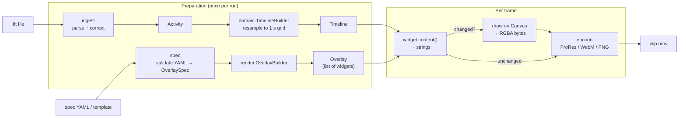
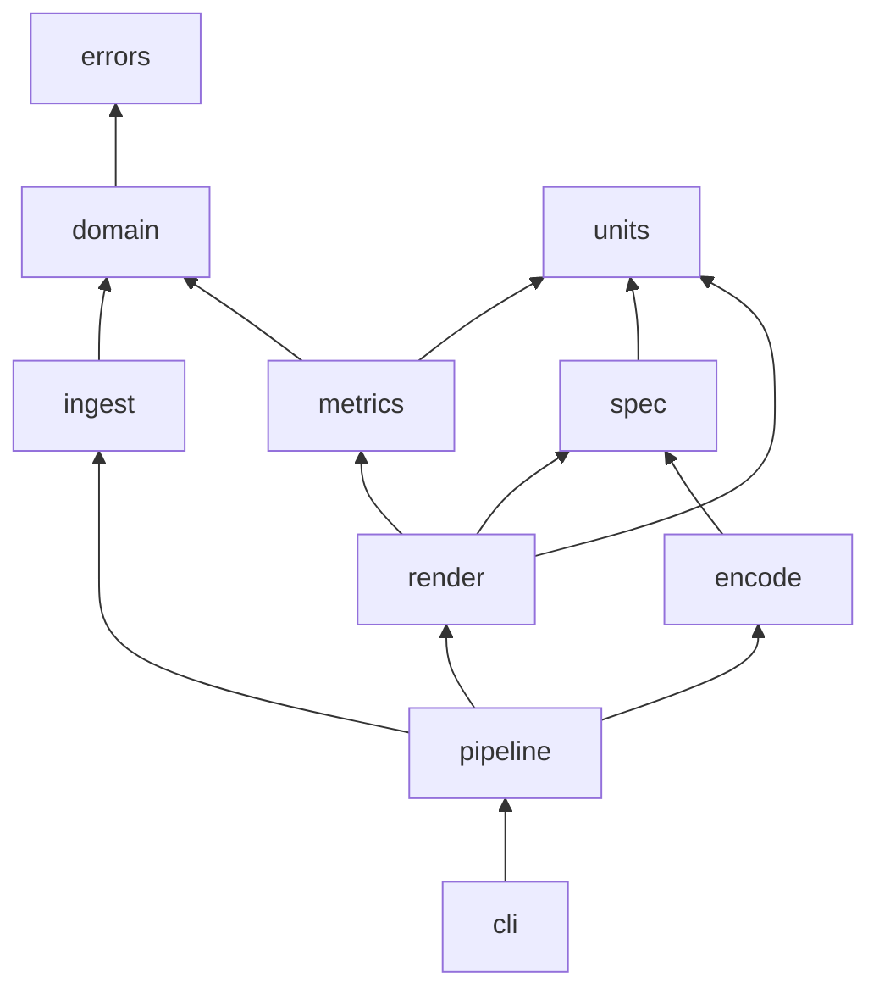
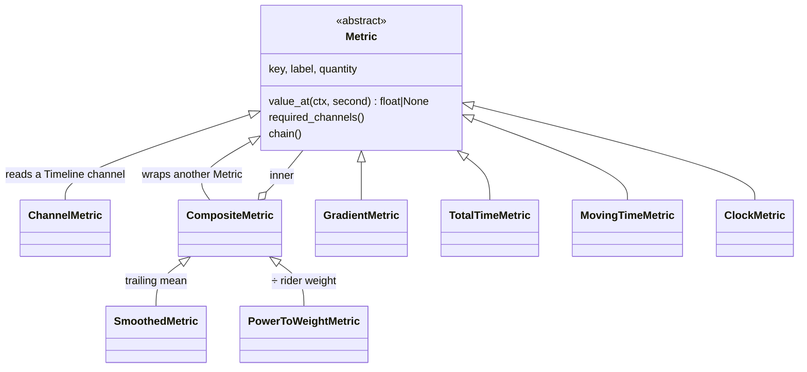
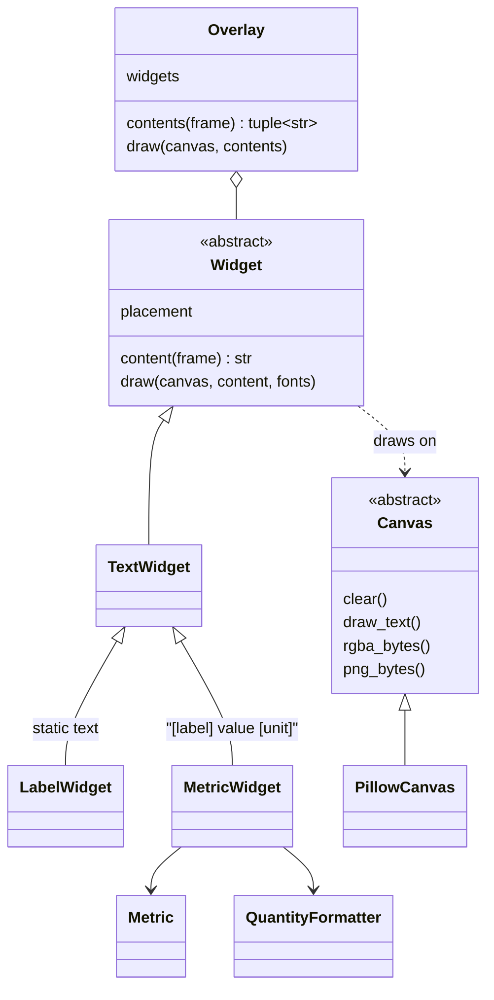
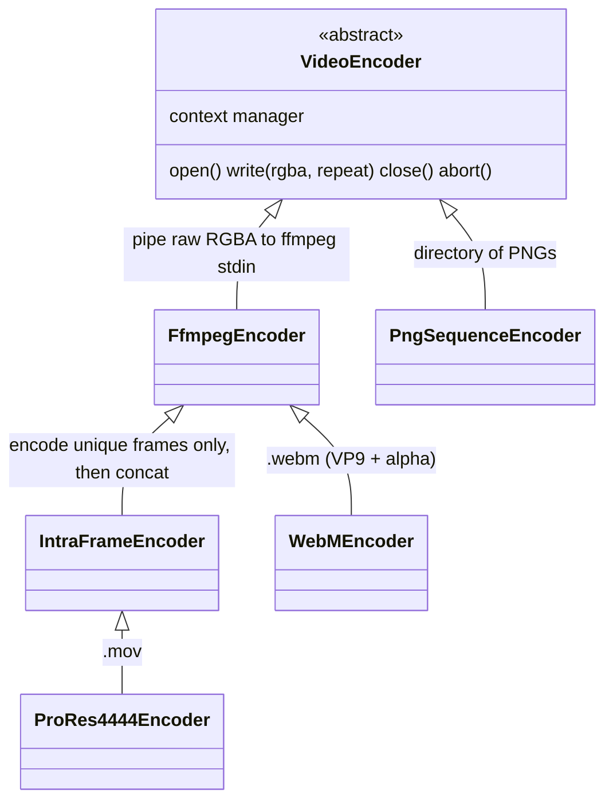
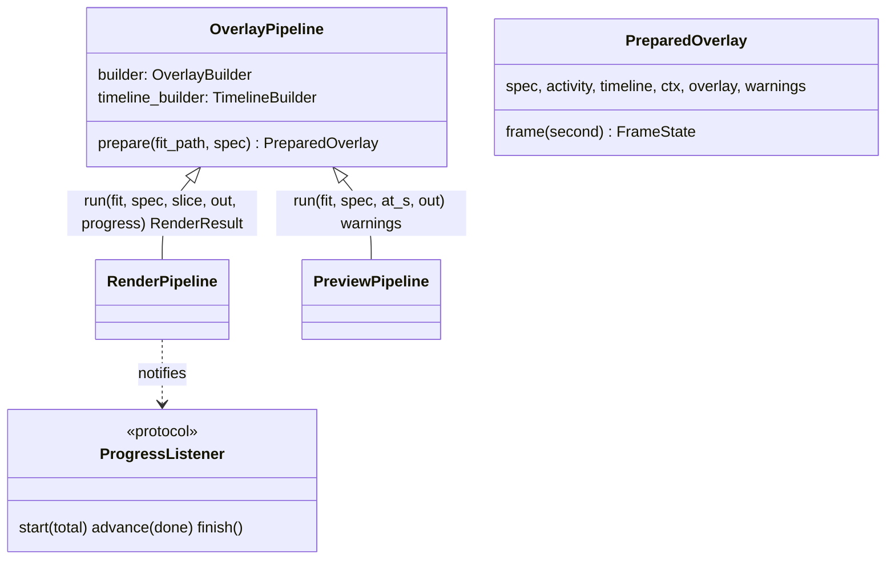
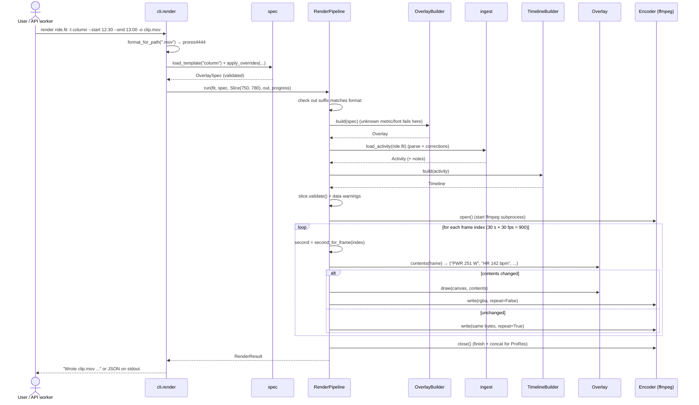
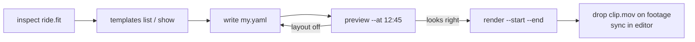
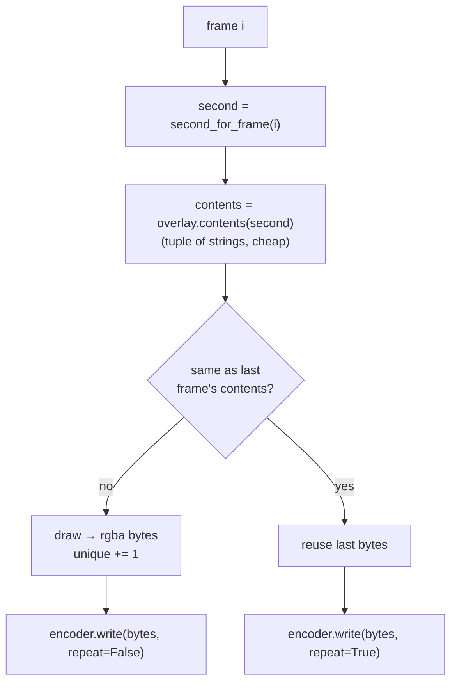
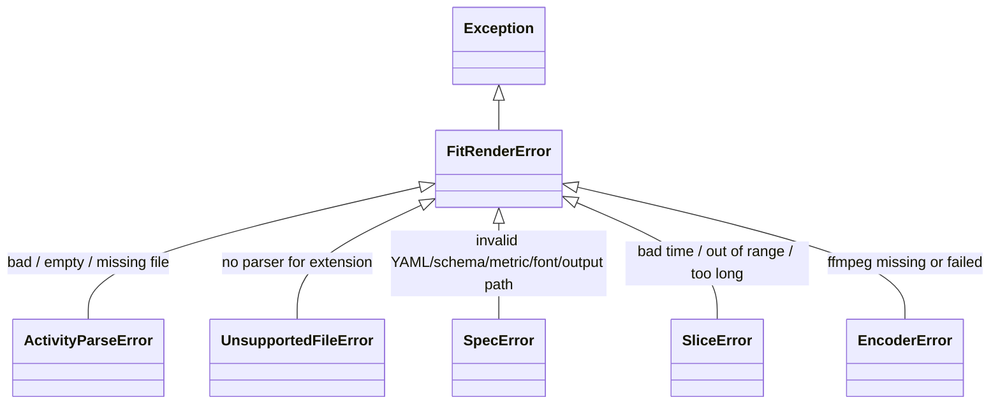

# render-cli — Architecture & Design Review

> **Audience:** a human who wants to understand how `fit-render` works without reading all
> ~2,700 lines of source. Part 1 explains the design. Part 2 reviews it critically.
>
> **Snapshot:** written 2026-11-17 against `main` @ `125855c` (phase 1 complete, speed-from-distance
> correction merged). At that commit: 94 tests pass, `mypy --strict` is clean.
>
> Related docs: [`README.md`](README.md) (usage), [`AGENTS.md`](AGENTS.md) (rules for contributors),
> [`PLAN.md`](PLAN.md) (next milestones M7–M10), [`../docs/PLAN.md`](../docs/PLAN.md) (product decisions).

---

## Contents

**Part 1 — How it works**

1. [What the program does](#1-what-the-program-does)
2. [The big picture](#2-the-big-picture)
3. [Package map and dependency rules](#3-package-map-and-dependency-rules)
4. [Key ideas and vocabulary](#4-key-ideas-and-vocabulary)
5. [Layer by layer](#5-layer-by-layer)
6. [Workflows](#6-workflows)
7. [The time model, worked through](#7-the-time-model-worked-through)
8. [Why rendering is fast: frame de-duplication](#8-why-rendering-is-fast-frame-de-duplication)
9. [The external contract](#9-the-external-contract)
10. [Errors](#10-errors)
11. [Packaging and runtime](#11-packaging-and-runtime)
12. [Testing strategy](#12-testing-strategy)
13. [Extension points](#13-extension-points)

**Part 2 — Review**

14. [Strengths](#14-strengths)
15. [Issues and risks](#15-issues-and-risks)
16. [Recommendations](#16-recommendations)
17. [Is it ready for M7–M10?](#17-is-it-ready-for-m7m10)

---

# Part 1 — How it works

## 1. What the program does

`fit-render` takes three inputs:

1. A **`.fit` file**: the activity recording from a bike computer, watch or training app.
2. An **overlay spec**: a YAML description of which numbers to show, where, and how big. You
   can pick a built-in template or write your own.
3. A **slice**: a start and end time, measured from the start of the activity.

It produces a **transparent video**. Every pixel is see-through except the text (power,
heart rate, speed, and so on). You drop this video on a track above your ride footage in
Premiere, Final Cut or Resolve and line it up yourself. The program never sees your video.

```
fit-render render ride.fit -t column --start 12:30 --end 13:00 -o clip.mov
```

## 2. The big picture

Data moves through one straight pipeline. Each stage has its own subpackage.



In plain words:

1. **Ingest** reads the FIT file into a format-neutral `Activity` (a list of samples plus
   timer start/stop events). It then runs **corrections** that repair known data defects.
2. **Timeline** resamples the activity onto a strict grid of **one value per second**. It
   also works out when the rider was stopped or moving.
3. **Spec** loads and validates the YAML into an immutable `OverlaySpec`.
4. **Builder** turns the spec (plain data) into live **widget** objects. Each widget is
   tied to a **metric** (for example "3-second average power").
5. **Render loop**: for every video frame, find which activity second it shows, ask every
   widget for its text, and redraw only if that text changed.
6. **Encode** pipes the frames to ffmpeg, which writes a transparent video file.

## 3. Package map and dependency rules

```
src/fit_render/
  errors.py      Exception hierarchy (all user errors derive from FitRenderError)
  domain/        Activity, Record, TimerEvent, Channel; Timeline + TimelineBuilder; Slice
  ingest/        ActivityParser (ABC) → FitParser; ParserRegistry; corrections; load_activity()
  units/         Quantity, UnitSystem, formatters, MISSING = "--"
  metrics/       Metric (ABC) and its subclasses; MetricRegistry
  spec/          Pydantic schema (OverlaySpec), YAML loader, template access, CLI overrides
  render/        Canvas (ABC) → PillowCanvas; FontLibrary; Placement; Widgets; Overlay; OverlayBuilder
  encode/        VideoEncoder (ABC) → FfmpegEncoder → IntraFrameEncoder → ProRes; WebM; PNG seq
  pipeline.py    OverlayPipeline → RenderPipeline / PreviewPipeline (the programmatic API)
  cli.py         Typer commands (thin shell over pipeline.py)
  templates/     Built-in YAML specs (minimal, column, bottom-bar, vertical)
  assets/fonts/  Roboto Mono Regular/Bold (+ OFL licence)
```

**The rule:** lower layers never import higher ones. `domain` and `units` import nothing
from the package (apart from `errors`). Nothing imports `cli`. Each subpackage exposes its
public API through its `__init__.py`.



*(Arrows point from a package to the package it depends on. `errors` is imported by almost
everything and is only drawn once.)*

What this layering gives you:

- **Swap the input format** (GPX/TCX) by changing only `ingest`. Nothing downstream knows
  the source was FIT.
- **Swap the drawing library** (Skia, Cairo) by changing only `render/canvas.py`.
- **Swap the front end.** `pipeline.py` is the real API. The CLI is one consumer, and a
  future in-process API could be another.

## 4. Key ideas and vocabulary

| Term | Meaning |
|---|---|
| **Record** | One sample from the device: timestamp + a dict of channel values (+ GPS). |
| **Channel** | A raw recorded stream, in SI units: `power` W, `heart_rate` bpm, `speed` m/s, `cadence` rpm, `altitude` m, `distance` m. |
| **Activity** | Parsed file: records, timer events, rider weight, UTC offset, sport, data-quality `notes`. |
| **Activity second** | An integer. Second 0 is the first record. The clock runs on through stops. Every slice time and metric lookup uses activity seconds. |
| **Timeline** | One value per channel per activity second, plus a `moving` flag per second. |
| **Metric** | Answers "what is the value of X at activity second N?" It returns an SI float, or `None` when unknown. |
| **Quantity** | What a metric measures (power, speed, duration…). It picks the formatter. |
| **Spec** | A YAML overlay description: *what* to draw and *where*, never *how*. |
| **Widget** | A runtime object made from a spec entry. It reports its text (`content`) and paints it (`draw`). |
| **Overlay** | All the widgets for one render (Composite pattern). |
| **Slice** | `[start_s, end_s)` in activity seconds. Over 30 s gives a warning; over 180 s is an error. |
| **Unique frame** | A frame whose text differs from the previous frame. Only unique frames are drawn and encoded. |

## 5. Layer by layer

### 5.1 `domain` — the neutral model

**Files:** `domain/activity.py`, `domain/timeline.py`, `domain/slice.py`

- `Activity`, `Record` and `TimerEvent` are **frozen dataclasses**. Once parsed, nothing
  mutates them. Corrections produce new copies with `dataclasses.replace`.
- `TimelineBuilder.build(activity)` is where the domain rules live (see
  [§7](#7-the-time-model-worked-through)):
  - It places each record in its integer second. If a second has several samples, the
    last one wins.
  - It **forward-fills** gaps of ≤ 2 s (recording jitter). Longer gaps stay `None`, which
    displays as `--`.
  - It computes **timer running** per second from START/STOP events. A STOP takes effect
    one second *after* its timestamp.
  - It treats **recording gaps** longer than 10 s as pauses, even without timer events.
  - While stopped, with no data: speed, power and cadence become 0, and distance and
    altitude hold their last value.
  - **Moving** means the timer is running AND speed ≥ 0.5 m/s. Unknown speed counts as
    moving.
  - It keeps only the channels that actually appear in the file.
- `Timeline` precomputes a **prefix sum** of moving seconds, so moving time at any second
  is O(1).
- `Slice` parses `H:MM:SS` / `MM:SS` / `SS` and validates against the activity length.

### 5.2 `ingest` — files in, `Activity` out

**Files:** `ingest/base.py`, `ingest/fit.py`, `ingest/corrections.py`, `ingest/__init__.py`


- **Strategy + Registry.** `ActivityParser` is an ABC with a template method: `parse()`
  checks that the file exists and has records, and delegates the format-specific work to
  `_parse()`. `ParserRegistry` picks a parser by file extension.
- **`FitParser`** uses Garmin's official `garmin-fit-sdk`. It maps record fields to
  channels, preferring `enhanced_*` fields. It converts semicircles to degrees, reads timer
  events (`event == "timer"`), weight from `user_profile`, and sport. It derives the UTC
  offset from `activity.local_timestamp`, rounded to 15 minutes. **Truncated files are
  kept** as long as they decoded some records.
- **Corrections** (Strategy). Each `ActivityCorrection` looks at the *data*, never at the
  manufacturer. It returns the activity unchanged, or repaired with a human-readable
  `note`. The only correction today is `SpeedFromDistance`. If the median ratio of
  (Δdistance/Δt) to recorded speed falls outside 0.8–1.25, it recomputes speed from the
  distance slope over ±2 s. This fixes TrainerRoad's 3.6× speed bug.
- `load_activity(path)` = registry → parse → corrections. This is the single entry point.

### 5.3 `units` — numbers to text

**File:** `units/formatting.py`

- `Quantity` enum → `QuantityFormatter` strategy, looked up with `formatter_for()`.
- `NumberFormatter` scales SI to metric or imperial and rounds it. It never shows `-0.0`.
- `DurationFormatter` always shows hours (`0:12:05`), so the text width stays steady.
- `ClockFormatter` gives 24 h `HH:MM:SS`.
- `None` always formats as `MISSING = "--"`.

### 5.4 `metrics` — what value at second N?

**Files:** `metrics/base.py`, `metrics/derived.py`, `metrics/registry.py`



- A metric is **stateless**. Everything it needs comes in through `MetricContext`
  (timeline + rider weight) and the second. This makes it trivially testable and safe to
  share.
- **Decorator / composition.** `power_3s` is `SmoothedMetric(power, 3)`. A widget's
  `smoothing_s` wraps whichever metric it uses, so `power_to_weight` with `smoothing_s: 3`
  is `Smoothed(PowerToWeight(power))`. `chain()` walks the wrapped metrics, which lets the
  pipeline spot W/kg anywhere in a chain.
- `GradientMetric` looks back up to 30 s until it has covered ≥ 20 m, then returns
  rise/run. It returns `None` if it doesn't get that far, so gradient shows `--` while you
  are stopped.
- `ClockMetric` uses the device's UTC offset. If the file has none, it falls back to the
  **host machine's** time zone (see [§15](#15-issues-and-risks)).
- `MetricRegistry` maps spec keys (`"power_3s"`) to metric instances. Its
  `default_registry` holds the 12 built-in metrics.

### 5.5 `spec` — the overlay description

**Files:** `spec/models.py`, `spec/loader.py`, `templates/*.yaml`

- **Pydantic v2** models with `extra="forbid"` (typos are rejected) and `frozen=True`.
- `OverlaySpec` contains: `version: 1`, `units`, `rider.weight_kg`, `output` (size, fps,
  format), `style` (font, colour), and `widgets` (≥ 1).
- `WidgetSpec` is a **discriminated union** on `type` (`metric` | `label`). If `type` is
  missing, it defaults to `metric`.
- Every position and size is a **fraction of the frame**, so one spec works at any
  resolution or aspect ratio.
- Frame rates are stored as exact `Fraction`s (29.97 = 30000/1001).
- `apply_overrides()` dumps the spec, patches the CLI values, and **re-validates**, so
  overrides get exactly the same checks as a file would.
- Validation errors become a single `SpecError` that lists each `field.path: message`.

### 5.6 `render` — widgets and pixels

**Files:** `render/builder.py`, `render/widgets.py`, `render/layout.py`, `render/canvas.py`, `render/fonts.py`



- **`OverlayBuilder` (Factory)** maps each widget spec type to a factory method. It
  resolves the metric name against the registry (this is where an unknown metric is
  caught), wraps smoothing, checks the font exists, and parses the colour.
- **Two-step rendering**, the core design decision:
  - `content(frame) -> str` is cheap. It computes the text the widget would show.
  - `draw(canvas, content)` is expensive. It paints that text.

  Splitting them lets the pipeline skip drawing when nothing changed
  ([§8](#8-why-rendering-is-fast-frame-de-duplication)).
- **`Placement`** turns `anchor` + fractional `offset` + `size` into pixel coordinates and
  a Pillow text anchor. The vertical anchor uses font metrics (ascender/descender), not
  glyph bounds, so text doesn't shift as digits change.
- **`Canvas` (Bridge)**: widgets never touch Pillow directly. Output is **straight
  (un-premultiplied) alpha**: transparent background, and anti-aliased edge pixels keep the
  text colour.
- **`FontLibrary`** loads bundled fonts by short name and caches them per pixel size. Only
  monospace fonts are allowed, so digits are equal width and values don't jiggle. A test
  enforces this.

### 5.7 `encode` — frames to files

**Files:** `encode/encoders.py`, `encode/ffmpeg.py`, `encode/__init__.py`



- Each encoder is a **context manager**. A clean exit calls `close()`, which finalises the
  file. An exception calls `abort()`, which kills ffmpeg and deletes the partial output.
- `write(rgba, repeat=True)` tells the encoder "same as the last frame", and each encoder
  uses that hint its own way:
  - **ProRes** (`IntraFrameEncoder`) doesn't send repeats to ffmpeg at all (see §8).
  - **WebM** sends every frame. VP9 is inter-frame, so repeats cost almost nothing.
  - **PNG sequence** re-writes the last compressed PNG bytes instead of re-compressing.
- `find_ffmpeg()` checks `$FFMPEG_PATH`, then `ffmpeg` on `PATH`, then the static binary
  bundled with the `imageio-ffmpeg` wheel. That's why no system install is needed.
- `ENCODERS` maps `OutputFormat` → encoder class. `format_for_path()` guesses the format
  from the `--out` suffix.

### 5.8 `pipeline` — the programmatic API

**File:** `pipeline.py`



- `prepare()` builds the overlay **before** parsing the file, so a bad spec fails fast. It
  then loads the activity, builds the timeline, picks the rider weight (spec weight wins,
  then the FIT profile), and collects **data warnings**: correction notes, channels the
  widgets need but the file lacks, and W/kg without a weight.
- `RenderPipeline.run()` runs the frame loop. `second_for_frame()` uses exact integer
  maths (`index * den // num`), so 29.97 and 59.94 fps never drift.
- `ProgressListener` is an **Observer** protocol. The CLI provides a Rich progress bar, an
  NDJSON emitter, or a no-op.
- `RenderResult.to_dict()` is the JSON contract ([§9](#9-the-external-contract)).

### 5.9 `cli` — the shell

**File:** `cli.py`

Typer commands: `render`, `preview`, `inspect`, `metrics`, `templates list`,
`templates show`. Each command resolves the spec (template *or* `--spec`, then
overrides), calls the pipeline, catches `FitRenderError` and turns it into a red one-line
message with exit 1, and prints either human output (Rich) or JSON.

## 6. Workflows

### 6.1 `render` — the main path



### 6.2 `preview` — check a layout

This uses the same `prepare()`, then renders **one** frame at `--at` to a PNG. It's the
quick loop for editing a spec: `templates show` → edit YAML → `preview` → repeat.

### 6.3 `inspect` — what's in this file?

`load_activity()` → `TimelineBuilder.build()` → summary: sport, start (UTC), UTC offset,
duration, moving/stopped time, record count, rider weight, GPS present, **% coverage per
channel**, and correction notes. Use `--json` for machines. This is how a user (or the
future UI) finds the time range to slice.

### 6.4 `metrics` / `templates list|show`

These are discovery commands. They list registered metric keys, fonts, sizes and frame
rates, and list or print the built-in templates.

### 6.5 Typical user journey



## 7. The time model, worked through

This is the subtlest part of the code. Take the synthetic test ride (`tests/fitgen.py`):
600 s long, auto-pause from 200 s to 260 s (no records), and an HR dropout from 300 s to
312 s.

These are the real values `TimelineBuilder` produces for that ride:

| Activity second | Records? | Timer | Speed | Power | HR | Distance | Moving? | Moving time |
|---|---|---|---|---|---|---|---|---|
| 199 (STOP stamped here¹) | yes | running | 28.8 km/h | 243 W | 139 | 1.592 km | ✅ | 0:03:20 |
| 200 – 201 | **no** | stopped | 28.8 ⚠️ | 243 ⚠️ | 139 ⚠️ | holds | ❌ | 0:03:20 |
| 202 – 259 | **no** | stopped | **0.0** | **0** | **--**² | **holds** 1.592 | ❌ | 0:03:20 |
| 260 (START) | yes | running | 28.8 | 238 | 146 | 1.600 | ✅ | 0:03:21 |
| 300 – 301 | yes, no HR | running | 28.8 | … | 149 (**filled**³) | … | ✅ | … |
| 302 – 311 | yes, no HR | running | 28.8 | … | **--** | … | ✅ | … |

1. Devices stamp STOP with the last record's time, so a STOP takes effect the *next* second (200).
2. HR isn't a "zero when stopped" channel. Your heart still beats, so it shows missing.
3. Gaps up to 2 s are forward-filled as recording jitter.

⚠️ **Seconds 200–201 contradict the documented rule.** The 2 s forward-fill runs *before*
the stopped-value rules, so the first two stopped seconds still show the last moving values.
Only after that does speed drop to 0 (`moving` is correct throughout). See finding #3 in
[§15](#15-issues-and-risks).

Other rules:

- The clock keeps running through the stop. `total_time` at second 259 reads `0:04:19`,
  while `moving_time` has paused.
- **No timer events** (some apps): moving = speed ≥ 0.5 m/s alone.
- **Recording gap > 10 s** with no events (TrainerRoad just stops recording): treated
  exactly like a timer stop. Gaps of 3–10 s (smart recording) are *not* stops. They show
  `--` after the 2 s fill.

## 8. Why rendering is fast: frame de-duplication

The values only change **once per second**, but video runs at 30 or 60 frames per second.
So at 30 fps roughly 29 of every 30 frames are identical to the one before.



**The ProRes trick (`IntraFrameEncoder`).** ProRes compresses each frame on its own (every
frame is a keyframe), so an encoded frame can be copied without re-encoding:

1. Send only the **unique** frames to ffmpeg. ffmpeg's segment muxer writes each one to
   its own tiny file (`u000000.mov`, `u000001.mov`, …).
2. Record, for every output frame, which unique frame it uses: `[0,0,0,…,1,1,1,…]`.
3. Write an `ffconcat` playlist that lists those files in order, with repeats, and run
   ffmpeg with `-c copy` to stitch them together **without re-encoding**.

The result is a normal constant-frame-rate `.mov` with exactly the right frame count,
about **25× faster** than encoding every frame. `_assemble()` checks that ffmpeg produced
exactly the expected number of unique segments.

**Contract for widget authors:** `content()` must capture *everything visible*. If two
frames return the same strings, they are treated as pixel-identical.

## 9. The external contract

The future API worker will run `fit-render` inside its Docker image and parse its output.
These are therefore **public interfaces**. Change them deliberately.

| Interface | Shape |
|---|---|
| `render … --json` | One JSON object on stdout: `output, format, width, height, fps, start, end, frames, unique_frames, elapsed_s, warnings` |
| `inspect FILE --json` | `file, sport, start_utc, utc_offset_h, duration, duration_s, moving_time, stopped_time, records, rider_weight_kg, has_gps, channels_coverage_pct, notes` |
| `--progress json` | NDJSON on **stderr**: `{"event":"start","total"}`, `{"event":"progress","done","total","percent"}` (at most once per %), `{"event":"finish","total"}` |
| Exit codes | `0` ok · `1` `FitRenderError` (one-line message on stderr, no traceback) · `2` usage error (Typer) |
| Spec YAML | `version: 1` schema in `spec/models.py`. Unknown keys are rejected. |

## 10. Errors



The rule is: **anything a user can cause raises a `FitRenderError` subclass with a clean
message.** The CLI catches only this base class. Anything else is a bug and *should*
produce a traceback.

## 11. Packaging and runtime

- **Python 3.12**, managed by `uv` (`uv.lock` committed). Build backend: hatchling.
- **Runtime deps:** `garmin-fit-sdk`, `imageio-ffmpeg` (bundles a static ffmpeg with
  `prores_ks` and `libvpx-vp9`), `pillow`, `pydantic`, `pyyaml`, `typer`.
- **Dockerfile:** `python:3.12-slim` + uv. The dependency layer is cached separately from
  the source layer. A build-time smoke test runs `fit-render --version` and `find_ffmpeg()`.
  The container runs as non-root uid 1000 with `WORKDIR /work`, and its entrypoint is
  `fit-render`. Usage: `docker run --rm -v "$PWD:/work" fit-render render …`.
- **Quality gates:** `ruff format`, `ruff check` (E, F, W, I, B, UP, SIM, RUF, PT),
  `mypy --strict` (with the pydantic plugin), `pytest`.

## 12. Testing strategy

| File | Covers |
|---|---|
| `tests/fitgen.py` | Writes **synthetic, deterministic FIT files** with the Garmin SDK encoder. `RideShape` controls the stop, HR dropout, climb, weight, UTC offset, power, timer events and speed scale. |
| `test_domain.py` | Time parsing, slice validation, gap fill, stop handling, recording-gap pauses, real-ride gap. |
| `test_ingest.py` | Parsing, sorting, missing data, bad files, the speed-from-distance correction, real fixtures. |
| `test_metrics_units.py` | Raw/smoothed/derived metrics, stop behaviour, times, registry, every formatter. |
| `test_spec.py` | Every built-in template loads **and builds**, defaults, fps, invalid specs, overrides, files. |
| `test_render.py` | Placement maths, widget text, **straight alpha** pixels, equal-width digits in every font. |
| `test_pipeline.py` | Frame → second maths at NTSC rates, format inference, PNG sequence, path/slice errors, preview + warnings, and **`@ffmpeg` tests that render ProRes/WebM and check codec, alpha and frame count**. |
| `test_cli.py` | `inspect --json`, the template show → spec round trip, `render --json`, clean exit-1 errors. |
| `tests/fixtures/*.fit` | Real rides, auto-parametrised (currently one trimmed TrainerRoad ride). |

Run `uv run pytest -m "not ffmpeg"` for the fast loop.

## 13. Extension points

| To add… | Do this | Touches |
|---|---|---|
| A metric | Subclass `Metric` (or wrap one with `CompositeMetric`), register it in `build_default_registry()` | `metrics/` (+ `units/` if it's a new quantity) |
| A widget type | `*WidgetSpec` + `Tag` in `spec/models.py`, `Widget` subclass, builder factory entry | `spec/`, `render/` |
| An output format | Subclass `FfmpegEncoder` / `IntraFrameEncoder`, add an `OutputFormat` value and an `ENCODERS` entry | `spec/`, `encode/` |
| An input format | Subclass `ActivityParser`, register it in `ingest/__init__.py` | `ingest/` |
| A data fix | Subclass `ActivityCorrection`, add it to `DEFAULT_CORRECTIONS`, emit a note | `ingest/` |
| A template | Drop a YAML file in `templates/` (tests build it automatically) | `templates/` |
| A drawing backend | Subclass `Canvas` | `render/canvas.py` |

---

# Part 2 — Review

## 14. Strengths

1. **Clean, enforced layering.** Dependencies only point downward, and each subpackage has
   one job and a narrow public API. The new speed correction (PR #4) slotted into `ingest`
   without touching anything else, which shows the design is working.
2. **The domain rules are explicit and tested.** Stop semantics, the STOP +1 s offset,
   gap thresholds and moving detection all live in one place (`TimelineBuilder`), with
   named, documented parameters and focused tests.
3. **The content/draw split is an excellent decision.** It makes de-duplication generic
   (any widget gets it for free) and delivers a ~25× speed-up for ProRes, without
   compromising output correctness (CFR, exact frame count).
4. **Exact time maths.** `Fraction` frame rates and integer frame → second conversion
   remove a whole class of drift bugs at 29.97/59.94.
5. **Immutable data everywhere.** Frozen dataclasses and frozen Pydantic models mean there
   is no hidden state between pipeline stages. Metrics are pure functions of
   `(ctx, second)`.
6. **The spec is good at catching user errors.** `extra="forbid"`, re-validated overrides,
   aggregated error messages, and fractional geometry independent of resolution.
7. **The machine contract was designed in from the start.** `--json`, NDJSON progress and
   typed exit codes are exactly what the phase-2 worker needs.
8. **Tests rely on synthetic data, not binary blobs.** `fitgen.RideShape` makes edge cases
   cheap to reproduce, and real fixtures are auto-parametrised.
9. **Self-contained runtime.** The bundled ffmpeg means `uv sync` alone gives a working
   tool, and Docker gives a reproducible one.

## 15. Issues and risks

Ordered by how much they matter. Only #3 is a behaviour bug in today's output. The rest are
gaps and risks.

| # | Severity | Issue | Where | Why it matters |
|---|---|---|---|---|
| 1 | **High** | **CI was not committed.** `.github/workflows/render-cli.yml` was written in phase 1 but never pushed (it sat in a git stash because the token then lacked `workflow` scope), so `main` had no CI. **Added in the PR that adds this document (#5).** | repo root | Nothing enforces ruff/mypy/pytest on PRs. This is the main safety net for the "must not regress" list. (Pushing workflow files needs a token with `workflow` scope, so you may have to add it yourself.) |
| 2 | Medium | **`rich` is used but not declared.** `cli.py` imports `rich` directly. It's only installed because `typer` depends on it. | `cli.py:17-19`, `pyproject.toml` | If a future Typer release makes Rich optional (it has been discussed upstream), the CLI breaks on a fresh install or Docker build. |
| 3 | **Medium** | **Stops show stale values for 2 s.** `_fill()` forward-fills before `_apply_stopped_values()`, so the first two seconds of every stop show the last speed/power/HR instead of 0 / `--`. | `domain/timeline.py` `build()` | It contradicts the documented rule in `AGENTS.md`. The unit test uses `max_gap_s=0`, which hides it. The visual effect is small (the rider has usually slowed already), but a brake-to-stop clip will hold its speed for 2 s. Fix: skip forward-fill on seconds where the timer isn't running (or fill only while running), and test it with the default `max_gap_s`. |
| 4 | Medium | **The clock falls back to the host time zone.** If the FIT file has no UTC offset, `ClockMetric` uses `astimezone()`. | `metrics/derived.py:86` | The same file renders different clock values on your PC and in Docker (which is UTC). The phase-2 worker runs in Docker, so users would see UTC times. |
| 5 | Medium | **`inspect` logic lives in the CLI.** Channel coverage, moving/stopped totals and the summary dict are computed in `cli.inspect`. | `cli.py:229-260` | This breaks the "no business logic in CLI" rule. The phase-2 API needs the same summary (plus downsampled series for charts) and would have to duplicate it or shell out. |
| 6 | Low–Med | **Spec validation happens in two places.** Schema checks are in `spec`, but unknown metrics/fonts are only caught by `OverlayBuilder.build()`. | `spec/`, `render/builder.py` | An API "validate this spec" endpoint must remember to build the overlay too. It's easy to accept a spec that later fails. |
| 7 | Low | **The W/kg warning is a type check.** `_data_warnings` uses `isinstance(link, PowerToWeightMetric)` to find out whether weight is needed. | `pipeline.py:110` | This is a special case. The next metric that needs weight (or FTP for zones) will need another `isinstance`. A `Metric.requires_weight()` hook (like `required_channels()`) would generalise it. |
| 8 | Low | **Metrics are evaluated per frame, not per second.** `contents()` runs every metric on every frame even though the second only changes every 30–60 frames. | `pipeline.py:171` | Cheap today. M10 aggregates and M8 sparklines make metrics more expensive, so caching contents per second (or per `(second, clip)`) would be worth doing first. |
| 9 | Low | **Two classes named `TextStyle`.** `spec.TextStyle` (Pydantic, hex string) and `render.TextStyle` (dataclass, RGBA). | `spec/models.py:110`, `render/widgets.py:33` | Confusing when reading or importing. It will get worse when M9 adds outline and shadow styles. |
| 10 | Low | **Small encoder cleanup gaps.** `FfmpegEncoder` opens its stderr temp file in `__init__`, not `open()`. `PngSequenceEncoder` has no `abort()`, so a failed render leaves a partial frame directory. | `encode/encoders.py:76`, `PngSequenceEncoder` | Minor resource leak and an inconsistent failure state across formats. |
| 11 | Low | **The ProRes fast path depends on ffmpeg behaviour.** `-segment_time 0.0001` relies on the segment muxer splitting at every keyframe. | `encode/encoders.py:170` | It's guarded by the frame-count check and the `@ffmpeg` tests, but an `imageio-ffmpeg` upgrade could change it. Pin or test on upgrade. |
| 12 | Low | **The slice is validated after parsing.** `slice_.validate()` runs after `prepare()`, so an obviously bad slice (end ≤ start, > 180 s) still parses the whole file first. | `pipeline.py:157` | Wasted seconds on long rides, and slower error feedback in the UI. The duration-independent checks could run first. |
| 13 | Low | **The JSON contract isn't versioned or schema-tested.** | `pipeline.py` `RenderResult.to_dict`, `cli.inspect` | The worker will parse these. A `"schema": 1` field plus a test that pins the key set would make accidental breaking changes visible. |
| 14 | Info | **Two plan documents.** `docs/PLAN.md` (product, phases) and `render-cli/PLAN.md` (M7–M10). | docs | That's fine, but the styling decision ("no outline/shadow") already conflicts with M9. The M9 checklist notes this, so remember to update it. |

## 16. Recommendations

**Before phase 2 (API) starts:**

1. **Commit the CI workflow** (`.github/workflows/render-cli.yml`, path-filtered, runs on push
   and PR): `uv sync --frozen`, ruff format check, ruff check, mypy, `pytest` with coverage
   (including the `@ffmpeg` tests, since the bundled binary makes them cheap), and a `docker build`
   smoke test. *(Done in PR #5. Fixes #1.)*
2. **Declare `rich`** in `pyproject.toml`. *(One line. Fixes #2.)*
3. **Move `inspect` into the pipeline** as an `ActivitySummary` dataclass + `InspectPipeline`
   (or `summarise(activity, timeline)`), so the CLI only formats it. This is also the natural
   home for the "downsampled series for charts" that phase 2 needs. *(Fixes #5.)*
4. **Make the clock deterministic.** Either default to UTC and warn ("no time zone in file;
   clock shows UTC"), or add a `--tz` / `spec.timezone` override. *(Fixes #4.)*
5. **Version the JSON output** and add a contract test that pins the key sets. *(Fixes #13.)*
6. **Fix the 2 s stale values at stops.** Don't forward-fill into stopped seconds, and test it
   with the default `max_gap_s=2` against the `fitgen` ride (seconds 200–201). *(Fixes #3.)*

**Before or during M7–M10:**

7. **Cache `contents()` per activity second** in `RenderPipeline` (dict keyed by second).
   Note: M7's graph marker moves at pixel resolution but still once per second, so the
   cache stays valid. *(Fixes #8.)*
8. **Add `Metric.requires_weight()`** (or a general `requirements()` returning channels +
   rider attributes), and drive the pipeline warnings from it. *(Fixes #7.)*
9. **Rename** `spec.TextStyle` → `TextStyleSpec` before M9 adds `outline` and `shadow` to it.
   *(Fixes #9.)*
10. **Add a single `validate_spec(spec)` entry point** that runs both schema and build checks,
   for the API to call. *(Fixes #6.)*

**Housekeeping (any time):** move the stderr temp-file creation into `open()`, give the PNG
encoder an `abort()` that removes the directory it created, and run cheap slice checks
before parsing. *(#10, #12.)*

## 17. Is it ready for M7–M10?

Yes. The architecture fits the planned features well:

| Milestone | Fits because… | Watch out for… |
|---|---|---|
| **M7 Graph widget** | Widget/Canvas/Placement are the right seams. `content()` = marker pixel keeps de-dup working. | `Canvas` needs new primitives, and supersampling must keep straight alpha. `Placement` needs a box. `FrameState`/`MetricContext` must carry the clip. |
| **M8 Sparkline** | Same widget. `content()` = bucketed values in the window. | A dynamic line is drawn on every unique frame, so keep the content string cheap. |
| **M9 Outline/shadow** | Styling is resolved in one place (`OverlayBuilder._style`). | It changes the straight-alpha invariant for edge pixels. The plan already notes this. Do the `TextStyle` rename first. |
| **M10 Aggregates** | `CompositeMetric` is exactly the right base, and `chain()` already supports nesting. | Needs prefix arrays per render (metrics are stateless today, so the precompute needs a home, e.g. `MetricContext` or a `prepare(ctx)` hook). Cache per-second contents first (#8). |

The main prerequisites are **CI** (so the "must not regress" list is enforced while these
features land) and **putting the clip into `FrameState`/`MetricContext`**, which both M7
and M10 need.
